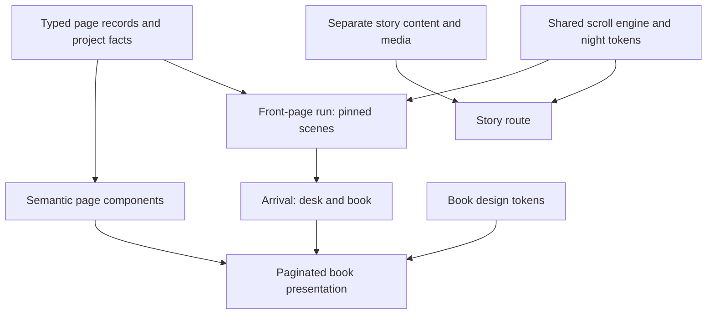

# Engineering Atlas architecture

[Overview](../README.md) · [Verification](VERIFICATION.md) · [Project instructions](../AGENTS.md)

The portfolio is a static React application. Its main design boundary is shared semantic content with separate presentation and interaction responsibilities.

## Content and presentation

[portfolio.ts](../src/data/portfolio.ts) defines stable page IDs, order, destinations, and factual copy. [book-pages.tsx](../src/components/book-pages.tsx) renders the book's content. The front-page run ([src/front/](../src/front/)) shows whole sentences from the same records, so a fact is written once. Keep facts in shared data rather than maintaining independent copy for the run and the book.

## Front-page run and arrival

`/` opens with a tall track whose sticky stage holds six scenes; scroll position is the playhead. [engine.ts](../src/trailer/engine.ts) writes 0..1 custom properties per scene and CSS derives transform, opacity and clip-path from them, so nothing is scroll-trapped and the browser's own scrolling is untouched. The same engine drives the story's trailer. At the end the stage dissolves into a second pinned block ([Arrival.tsx](../src/front/Arrival.tsx)) that holds a painted desk and the real book; the book's code loads only as the reader nears it, or at once for a link to `/#book`. Reduced motion and windows too short for a pinned stage get the same content as blocks in normal flow.

## Interaction responsibilities

The native page-turn engine owns sheet geometry and folding. [book-slider.tsx](../src/components/ui/book-slider.tsx) coordinates lifecycle, page selection, responsive modes, input, focus, and presentation. Motion handles separate UI transitions; it does not replace the native folding path. Reduced motion provides a still presentation of the same pages.

Page records are durable navigation contracts. Reordering content must not casually rename IDs or break deep links. Keyboard controls must defer to editable/interactive elements, and visible content/focus must agree with the active presentation. Some engine-owned DOM is copied; React state inside a copied face must not be assumed to remain live.

## Separate story route

[src/story/](../src/story/) contains personal narrative, archive/media associations, and its own presentation. Native document scrolling and the book's page engine solve different reading modes. Hosted media is an external dependency; player readiness, explicit playback, failure handling, and cleanup need their own verification. Do not infer full provider control from a cross-origin iframe.

## Build and delivery

Vite emits static assets into `dist/`; TypeScript checking precedes the build. [vite.config.ts](../vite.config.ts) contains project-specific asset/style/module-loading behavior. Fonts, portraits, diagrams, and imagery are served from the built site; external story media can load separately.

Root-relative assets assume root hosting. A Git commit, local build, and public deployment are different revisions/states. Verify the published URL's assets, routes, headers, and media before attributing local measurements to it. Chunk file names carry the build's hash.

## Engineering tradeoffs

| Choice | Benefit | Responsibility |
| --- | --- | --- |
| Shared semantic content | Consistent project facts across presentations | Keep navigation IDs and accessibility semantics stable |
| Native folding engine | Coherent page geometry and reversal | Review uninterrupted motion and copied DOM behavior |
| Scroll as playhead for the run | Native scrolling, no trapping, one engine for two pages | Keep content reachable by keyboard and in still mode; keep the story unchanged when shared rules move |
| Lazy story and book chunks | Fast first paint | A tab older than the deployed build reloads once when a chunk is missing |
| Static build | No portfolio API/service deployment | Verify root paths, host headers, and external media |

Screenshots prove a captured state. They do not establish live motion acceptance, field INP, physical-device smoothness, or every accessibility criterion. [Verification boundaries](VERIFICATION.md).
