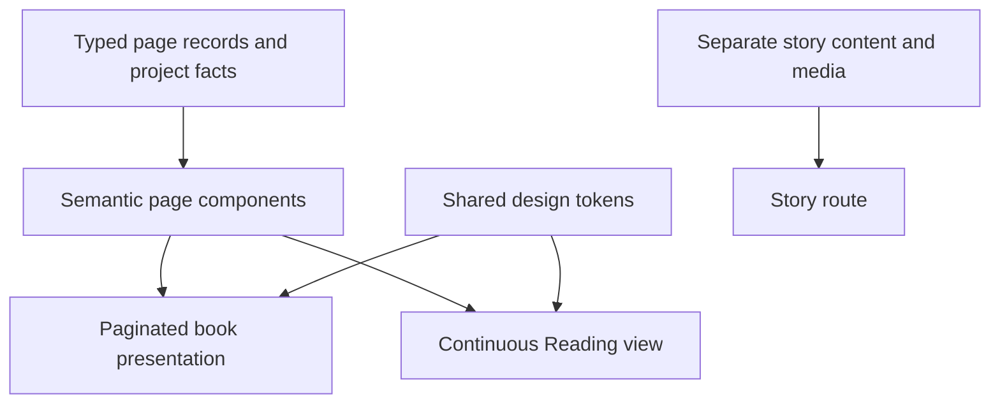

# Engineering Atlas architecture

[Overview](../README.md) · [Verification](VERIFICATION.md) · [Project instructions](../AGENTS.md)

The portfolio is a static React application. Its main design boundary is shared semantic content with separate presentation and interaction responsibilities.

## Content and presentation

[portfolio.ts](../src/data/portfolio.ts) defines stable page IDs, order, destinations, and factual copy. [book-pages.tsx](../src/components/book-pages.tsx) renders content; [reading-view.tsx](../src/components/reading-view.tsx) provides continuous flow. Keep facts in shared data/components rather than maintaining independent book and reader copy.

## Interaction responsibilities

The native page-turn engine owns sheet geometry and folding. [book-slider.tsx](../src/components/ui/book-slider.tsx) coordinates lifecycle, page selection, responsive modes, input, focus, and presentation. Motion handles separate UI transitions; it does not replace the native folding path. Reduced motion and Reading view provide alternative presentations.

Page records are durable navigation contracts. Reordering content must not casually rename IDs or break deep links. Keyboard controls must defer to editable/interactive elements, and visible content/focus must agree with the active presentation. Some engine-owned DOM is copied; React state inside a copied face must not be assumed to remain live.

## Separate story route

[src/story/](../src/story/) contains personal narrative, archive/media associations, and its own presentation. Native document scrolling and the book's page engine solve different reading modes. Hosted media is an external dependency; player readiness, explicit playback, failure handling, and cleanup need their own verification. Do not infer full provider control from a cross-origin iframe.

## Build and delivery

Vite emits static assets into `dist/`; TypeScript checking precedes the build. [vite.config.ts](../vite.config.ts) contains project-specific asset/style/module-loading behavior. Fonts, portraits, diagrams, and imagery are served from the built site; external story media can load separately.

Root-relative assets assume root hosting. A Git commit, local build, and public deployment are different revisions/states. Verify the published URL's assets, routes, headers, and media before attributing local measurements to it. This documentation commit changes no runtime source or hosting configuration.

## Engineering tradeoffs

| Choice | Benefit | Responsibility |
| --- | --- | --- |
| Shared semantic content | Consistent project facts across presentations | Keep navigation IDs and accessibility semantics stable |
| Native folding engine | Coherent page geometry and reversal | Review uninterrupted motion and copied DOM behavior |
| Continuous Reading view | Ordinary document flow | Preserve logical return position and focus |
| Static build | No portfolio API/service deployment | Verify root paths, host headers, and external media |

Screenshots prove a captured state. They do not establish live motion acceptance, field INP, physical-device smoothness, or every accessibility criterion. [Verification boundaries](VERIFICATION.md).
